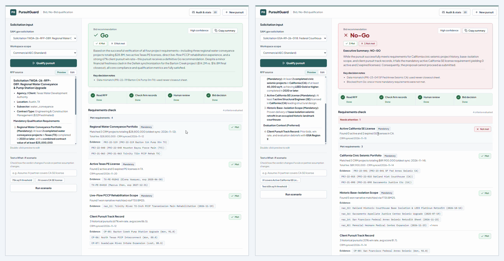
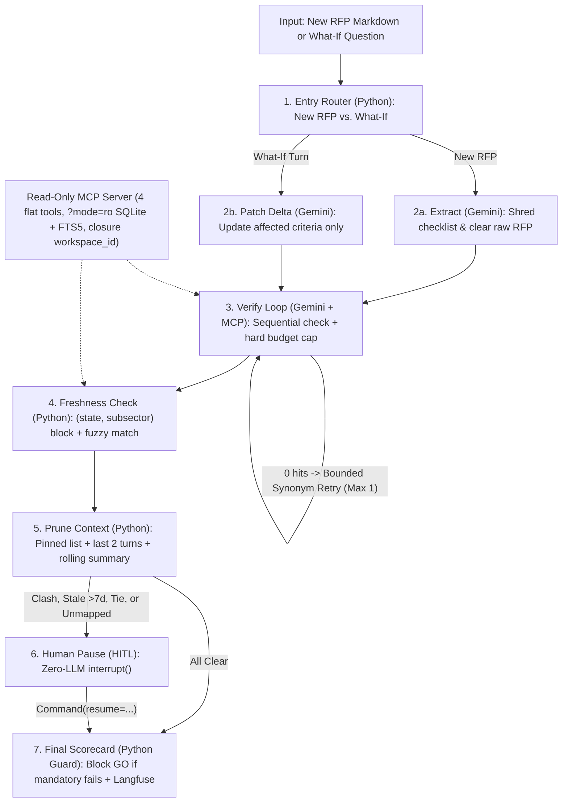

# PursuitGuard — AEC Go/No-Go Pursuit Qualification Agent


> Architecture, Engineering, and Construction (AEC) Go/No-Go pursuit qualification agent powered by a strictly read-only CRM MCP server, sequential stateful LangGraph orchestration, and deterministic guardrails.



---

## Why PursuitGuard?

Evaluating a new AEC solicitation (*"≥3 acute-care hospitals over 50,000 sq ft in Texas in the last 5 years + active TX PE license + occupied ICU phased scope"*) breaks generic RAG in three concrete ways:

1. **No Exact CRM Math:** Vector retrieval cannot reliably compute multi-field counts, combined fee sums, minimum square footage, or active vs. expired license thresholds.
2. **Stale CRM Syncs & Unmatched Project Titles:** Weekly-to-biweekly CRM snapshots drift from newer closeout sheets, and project titles rarely share clean IDs (`"Houston Methodist West Tower Expansion Closeout"` vs. `"PRJ-21-084 Methodist Hlth Ph2 (TX)"`).
3. **Unchecked Agent Autonomy:** Without read-only tool boundaries, workspace isolation, token caps, and human checkpoints, agents can burn tokens, leak restricted defense records, or emit `GO` over failed mandatory disqualifiers.

---

## Architecture



---

## Core Capabilities & Engineering Guardrails

- **Server-Bound Workspace Closure:** `build_mcp_server(bound_workspace_id, store)` locks tenant scope inside a Python closure; `workspace_id` never appears in any `@mcp.tool()` JSON Schema, blocking cross-tenant prompt injection.
- **Engine-Level Read-Only SQLite + FTS5:** `ReadOnlyPursuitStore` opens `file:data/crm.db?mode=ro` with `PRAGMA query_only = ON`, built-in SQLite FTS5 (BM25) narrative search (excluding drafts by default), and optional cached `gemini-embedding-2` Reciprocal Rank Fusion.
- **Blocked Fuzzy Freshness Reconciliation:** `(state, subsector)` blocking paired with RapidFuzz matching catches metric clashes between newer closeouts and CRM rows, ambiguous entity ties, and stale (`>7d`) CRM syncs without guessing.
- **Zero-Mutation Context Pruning:** `raw_rfp_text` is cleared immediately after structured extraction (`0 chars`), while multi-turn What-If sessions retain `pinned_requirements` + an explicit 2-turn window (`recent_turns[-2:]`) + a rolling `conversation_summary` (`-72.4%` cumulative 4-turn input tokens).
- **Deterministic Verdict Invariants & Zero-LLM HITL Gate:** `enforce_scorecard_invariants` guarantees no `FAILED` or unwaived `UNVERIFIABLE_NEEDS_HUMAN` mandatory requirement can ever emit `GO`; `interrupt()` pauses execution with zero LLM calls until a human resolves flagged items.
- **Decision-First UI:** Designed for Bid / Capture Managers — 3-second verdict banner with score counts and one-click **Copy summary**, blockers-first requirement grouping, 4 plain-English workflow steps, dynamic What-If scenario chips, independent pane scrolling, and an on-demand **Audit & stats** slide-over drawer.

---

## Verified Evaluation Results (14-Case Suite: Offline vs. Live)

Evaluated across 14 adversarial and multi-turn cases (`evals/cases.json`). **Offline** tests deterministic guardrails, SQL CRM math, fuzzy reconciliation, and token pruning with zero LLM variance (`LLM_PROVIDER=mock`); **Live** tests full end-to-end Gemini extraction, MCP tool selection, What-If patching, and summaries (`primary=gemini-4-hydrogen`, `light=gemini-3.5-flash-lite`).

| Metric | v1 Baseline | v2 Offline (Mock) | v2 Live (`gemini-4-hydrogen`) |
| :--- | :--- | :--- | :--- |
| End-to-End Case Pass Rate | 28.6% (4/14) | 100.0% (14/14) | 85.7% (12/14) |
| Unmatched Entity Freshness Recall | 0.0% (0/3) | 100.0% (3/3) | 100.0% (3/3) |
| Security & Mandatory Invariant Pass | 50.0% (1/2) | 100.0% (2/2) | 100.0% (2/2) |
| 4-Turn Cumulative Input Tokens | 7,040 | 1,940 (-72.4% vs. v1) | 15,580 in / 2,535 out* |
| Post-Pruning Turn-1 Pinned Recall | — | 100.0% | 100.0% |
| Agent Latency (p50 / p95) | — | < 0.12s | 28.24s / 50.58s |
| Avg Tokens & Est. Cost / Run | — | 0 (`$0.0000`) | 6,149 in / 1,171 out (~`$0.0048`) |

> **Live Mode Notes (12/14 — 2026-11-25):**
> - **`c06_draft_exclusion_ambulatory` (`forbidden_citation=nar_08`):** Draft records (`nar_06`, `nar_07`, `nar_09`) were excluded, but the live tool planner omitted the `subsector="acute_care"` filter on `search_project_narratives`, allowing a won AZ ambulatory record (`nar_08`) to match alongside TX acute-care hits.
> - **`c07_bounded_synonym_retry` (`retries=0 < min=1`):** The live model expanded *"telemetry step-down ward"* into broader acute-care terms on the initial pass, hitting on try 1 so the 0-hit synonym retry did not need to fire.
>
> *\*Live token counts reflect actual Gemini API `usage_metadata` across structured JSON schemas and system prompts (`11` end-to-end agent cases; `3` entity-resolution cases are deterministic Python). Cost estimates use Flash-tier reference pricing (`$0.30 / 1M` input, `$2.50 / 1M` output).*

---

## Quickstart (3 Commands)

```powershell
uv sync
uv run python data/seed_crm.py
uv run uvicorn src.api.app:app --reload
```

Open **`http://127.0.0.1:8000`** to run the sample SAM.gov solicitations, resolve human-review freshness/tie gates, and test What-If scenarios.

---

## Live Gemini / Vertex AI & Langfuse Configuration

Copy `.env.example` to `.env` and choose a live inference option (leave `LLM_PROVIDER=mock` for zero-cost offline runs):

1. **Option A — Gemini Developer API (Default live config via `genai.Client(api_key=...)`):**
   Set `LLM_PROVIDER=gemini`, `GEMINI_API_KEY=<your-gemini-api-key>`, `GEMINI_PRIMARY_MODEL=gemini-2.5-flash`, `GEMINI_LIGHT_MODEL=gemini-2.5-flash`, and `GOOGLE_GENAI_USE_VERTEXAI=false`.
2. **Option B — Google Cloud Vertex AI (Express Mode or Application Default Credentials):**
   Set `LLM_PROVIDER=vertex_gemini`, and provide either `GOOGLE_API_KEY` (Express Mode or project-bound with `GOOGLE_CLOUD_PROJECT`) or `gcloud auth application-default login` with `GOOGLE_CLOUD_PROJECT` and `GOOGLE_CLOUD_LOCATION=global`. Never commit `.env` or API keys to source control.

Run live evaluations:

```powershell
uv run python evals/run_evals.py --mode live
```

---

## Standalone Read-Only MCP Server

Run the stdio MCP server directly (`uv run python -m src.mcp_server.server`) to expose the 4 flat read-only tools scoped to the server-bound `workspace_id`:

- `query_projects` — Exact SQL filtering and aggregation across completed CRM projects (`state`, `subsector`, `role`, `min_sqft`, `min_year`, `leed_min`).
- `check_staff_credentials` — Verifies active vs. expired professional licenses (`PE`, `SE`, etc.) by state.
- `get_client_history` — Retrieves past pursuit win/loss history and debrief notes for a client/agency.
- `search_project_narratives` — Read-only FTS5 BM25 (plus optional cached RRF) search over closeout and scope narratives with draft exclusion.

---

## Project Structure

```text
pursuitguard/
├── data/
│   ├── narratives/          # Synthetic AEC closeout & scope narratives (incl. prompt-injection fixtures)
│   ├── rfps/                # Sample SAM.gov solicitations (GSA, TWDA, VA)
│   └── seed_crm.py          # Deterministic SQLite + FTS5 seeder
├── docs/
│   └── ui-preview.png       # PursuitGuard Bid/No-Bid UI preview
├── evals/
│   ├── cases.json           # 14-case adversarial & multi-turn benchmark suite
│   └── run_evals.py         # Offline & live evaluation runner
├── src/
│   ├── agent/               # LangGraph state, nodes, freshness matcher, guardrails, GenAI adapter
│   ├── api/                 # FastAPI SSE backend + lifespan management
│   ├── mcp_server/          # Read-only SQLite store & workspace-bound FastMCP server
│   ├── ui/                  # Self-contained light-mode single-page Bid/No-Bid Desk
│   ├── config.py            # Pydantic runtime settings
│   ├── logging_config.py    # Secret-safe console logging
│   └── observability.py     # Local JSONL traces + optional Langfuse v3 callbacks
├── tests/                   # Security, freshness, auth, logging, API, and graph lifecycle tests
├── .env.example             # Safe environment template
└── pyproject.toml           # Dependencies, Ruff, and Pytest config
```

---

## Development & Verification

```powershell
uv run ruff check src tests evals data
uv run pytest -v
uv run python evals/run_evals.py --mode offline
```
